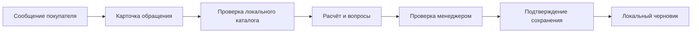

# «Тихий свет» — помощник менеджера по обращениям

**Из сообщения покупателя — в проверяемый черновик обращения.** Локальное веб-приложение для магазина светильников: собирает карточку с помощью OpenAI, сверяет товар с каталогом, рассчитывает расхождения и сохраняет результат после подтверждения менеджера.

Проект для портфолио: рабочий локальный прототип с исходным кодом, контрольными примерами и 20 автоматическими тестами. Сохранённый черновик не является заказом или резервом.

[Кейс для заказчика](docs/PORTFOLIO.md) · [Установка и работа](docs/USER_GUIDE.md) · [Сценарий демонстрации](docs/DEMO.md) · [Архитектура](docs/ARCHITECTURE.md) · [Проверки](docs/VERIFICATION.md) · [Скиллы для агента](skills/README.md)

## Какую задачу решает

В обращении покупателя могут одновременно быть пожелания по товару, количеству, бюджету и сроку, но не хватать контакта или адреса. Менеджеру нужно отделить эти пожелания от фактов каталога и уточнить расхождения до обещаний клиенту.

Приложение показывает исходное сообщение, данные каталога и расчёты раздельно. Неизвестные сведения остаются неизвестными, а решение о сохранении принимает менеджер.

## Возможности

| Этап | Результат | Контроль со стороны приложения |
| --- | --- | --- |
| Текстовый ответ | Сводка запроса и вопросы | Исходное сообщение доступно для сверки |
| Карточка | Товар, цвет, количество, бюджет, срок, контакт, адрес | Строгая схема JSON и проверка значений |
| Каталог | Цена, остаток, доступные сведения о поставке | Проверка имени и аргументов функции `get_catalog_item` |
| Расчёт | Стоимость, превышение бюджета, нехватка | Числа вычисляет код приложения |
| Сохранение | Локальная запись с уникальным ID | Подтверждение, актуальная версия и защита от дубля одной операции |



## Контрольный пример

> Нужны 12 белых ламп «Луна 01» для отеля. Бюджет до 60 000 ₽. Хотим получить их к 20 ноября.

| Проверка | Ожидаемый результат по демонстрационному каталогу |
| --- | --- |
| Цена × количество | 5 900 ₽ × 12 = **70 800 ₽** |
| Бюджет | 60 000 ₽; превышение **10 800 ₽** |
| Остаток | 8 шт.; не хватает **4 шт.** |
| Поставка | Дата неизвестна; «20 ноября» — пожелание покупателя |
| Что уточнить | Контакт, точный адрес, бюджет и возможность поставки |

Это контрольные данные из [examples/expected.json](examples/expected.json), а не результаты реальных продаж. Автотесты подтверждают расчёты и защитные проверки; извлечение данных настоящей моделью требует отдельного запуска пользователем.

## Быстрый старт

Нужны Node.js 24 или новее и npm. Текущий прогон тестов выполнен на Node.js 26.13.1.

```powershell
git clone https://github.com/IMayskiy/Application_Tihiy-Svet_API.git
cd Application_Tihiy-Svet_API
npm ci
Copy-Item .env.example .env
```

Откройте новый `.env` локально: укажите свой `OPENAI_API_KEY` и доступную вам модель в `OPENAI_MODEL`. Шаблон не содержит ключа. Поддержка настроек запросов зависит от модели; значение по умолчанию в коде не доказывает её доступность в аккаунте.

```powershell
npm start
```

Откройте [http://127.0.0.1:3030/](http://127.0.0.1:3030/). Для остановки нажмите **Ctrl+C**. Команда `npm run dev` запускает режим наблюдения за исходниками.

Без ключа можно открыть интерфейс и запустить тесты. Создание ответа, карточки, проверка каталога через модель и подтверждённое сохранение требуют настоящего API; имитации успешных ответов в пользовательских маршрутах нет. Запросы запускает пользователь кнопками. Они могут расходовать средства API.

## Проверка

```powershell
npm test
```

**16 ноября 2026 года: 20 из 20 тестов прошли локально**, без запросов к OpenAI, на отдельном тестовом транспорте. Проверяются схема карточки, расчёты, цикл вызова функций, актуальность данных, подтверждение и повторные операции. Подробнее: [границы проверки](docs/VERIFICATION.md).

## Технологии и файлы

JavaScript (ES modules), Node.js HTTP-сервер, официальный пакет `openai`, Responses API, Structured Outputs (ответ по строгой схеме), function calling (вызов разрешённых функций), HTML/CSS/JavaScript без клиентского фреймворка, локальное хранилище JSON.

```text
public/                 Интерфейс менеджера
server.mjs              Локальный сервер и маршруты
card.mjs                Структурированная карточка и проверка данных
catalog-service.mjs     Поиск товара, расчёты, функция каталога
crm.mjs                 Подтверждение и сохранение черновиков
errors.mjs              Сообщения об ошибках API
catalog.json            Демонстрационный каталог
examples/               Контрольные обращения и ожидаемые результаты
tests/                  Автотесты с отдельным транспортом
docs/                   Кейс, руководство, демонстрация, архитектура
skills/                 Новые проектные скиллы для сопровождения агентом
BRIEF.md                Исходные требования
ACCEPTANCE.md           Историческая приёмка от 10 ноября 2026 года
```

## Границы и данные

- Один локальный пользователь, сервер слушает только `127.0.0.1:3030`. Публичное размещение приложения и многопользовательский режим не реализованы.
- CRM (хранилище обращений) — `data/generated/crm.json`; файл создаётся при сохранении и исключён из Git. Это не интеграция с внешней CRM.
- Приложение запускается локально, но данные, используемые в запросах к модели, передаются в OpenAI. Используйте демонстрационные сообщения без реальных персональных данных.
- `.env`, локальные обращения, зависимости, кэш и резервные копии не входят в публикацию. Не передавайте их клиентам вместе с исходниками.
- Лимит 50 запросов за запуск сервера ограничивает число вызовов, а не стоимость. Проверка каталога и сохранение включают несколько вызовов.
- Доступ к реальному API, качество ответов модели и сценарий с реальным сохранением пользователь проверяет самостоятельно. Промышленная готовность и измеренная экономия времени не заявляются.

Проект можно обсуждать и демонстрировать по [сценарию](docs/DEMO.md). Лицензия на свободное распространение отдельно не предоставлена.
