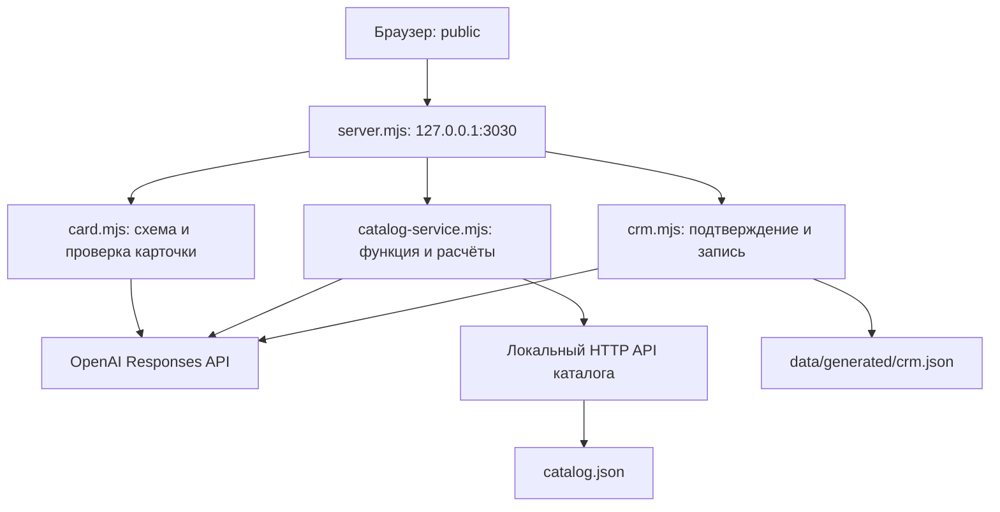

# Архитектура

## Компоненты

Модель извлекает сведения и вызывает разрешённые функции. Код проверяет аргументы, читает каталог, считает суммы и решает, допустима ли запись. Модель не получает право произвольно менять файлы или подтверждать действие за менеджера.

## Данные и состояние

- Строгая схема содержит девять обязательных полей; неизвестные значения допускают `null`. Дополнительные поля отклоняются.
- Количество при наличии должно быть положительным целым; бюджет — неотрицательным. Обязательные вопросы пересчитываются приложением.
- `ready_for_review` означает готовность к проверке, а не подтверждение поставки.
- Карточка имеет серверный токен. Проверка каталога создаёт версию для просмотра и сохранения. Изменение исходного сообщения отзывает карточку.
- Каталог ищет точное нормализованное название. Числа стоимости, превышения бюджета и нехватки вычисляет `calculate`, а не модель.

## Маршруты

| Метод и путь | Назначение |
| --- | --- |
| `GET /api/health` | Наличие настроенного клиента и имя модели; без проверки доступа к API |
| `GET /api/catalog?product_name=…` | Поиск в локальном каталоге |
| `GET /api/leads` | Список локальных черновиков, требуется cookie сессии |
| `POST /api/respond` | Текстовый ответ модели |
| `POST /api/card` | Построение и проверка карточки |
| `POST /api/check-catalog` | Цикл `get_catalog_item` для актуальной карточки |
| `POST /api/review` | Подготовка снимка и подтверждения; без записи |
| `POST /api/save` | Цикл `create_lead` и подтверждённая запись |
| `POST /api/save-status` | Проверка существующей записи без нового сохранения |
| `POST /api/invalidate` | Отзыв карточки |

POST-маршруты проверяют `Origin`; просмотр, сохранение, проверка статуса и отзыв требуют cookie сессии. Это защита локального сценария, не полноценная аутентификация для публичного сервиса.

## Подтверждение и повторные операции

`prepare` формирует снимок, ID операции и случайное подтверждение. Перед `create_lead` сервер сверяет подтверждение, снимок и актуальную версию. После первого ответа модели он дополнительно проверяет имя функции и неизменность аргументов.

`commit` последовательно выполняет записи: пишет временный файл, синхронизирует и переименовывает его. Хеш подтверждения хранится рядом с записью; наружу не возвращается. Повтор той же операции с тем же снимком возвращает сохранённую запись. Два разных намерения сохранения считаются разными операциями.

Ошибка второго ответа модели после записи не отменяет созданный черновик. Если ответ сервера потерян, интерфейс проверяет статус записи отдельно. Сохранённые данные переживают повторное создание объекта хранилища; незавершённые намерения и сессия находятся в памяти процесса.

## Ограничения

Состояние активной карточки общее для одного процесса, поэтому приложение рассчитано на одного пользователя. Каталог файловый, без резервирования остатков. Хранилище JSON не заменяет промышленную базу данных. Аварийное завершение процесса непосредственно во время записи не проверялось. Перед внешним размещением нужны отдельное проектирование доступа, хранения, эксплуатации и обработки данных.
